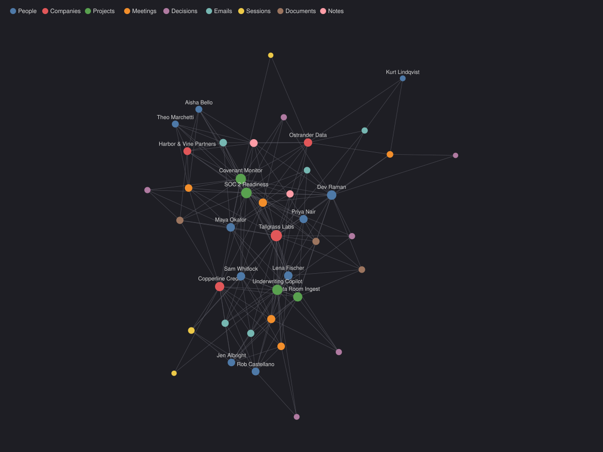
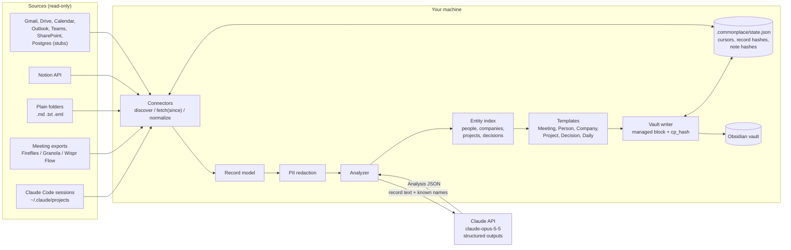

# commonplace

Turn the records a company produces (meeting transcripts, email threads, Notion
pages, Claude Code sessions, notes) into a local Obsidian vault where people,
companies, projects, meetings and decisions link to each other.

A commonplace book was the old practice of copying everything worth keeping
into one indexed notebook. This does the copying for an AI-native company,
where most of the record is already text: transcripts, threads, and
conversations with assistants.



*The demo vault's link graph: 42 notes and 185 links built from 21 synthetic
records. Daily notes are hidden here. Every name in it is invented.*

## What it does

1. **Connectors** read from each source, read-only, and only what changed since the last sync.
2. Each item is **normalized** to one record model.
3. Claude **classifies** the record (meeting, email thread, decision, project, ...)
   and **extracts** people, companies, projects, decisions and action items, in
   one structured-output call.
4. Each record is rendered through an Obsidian **template** with frontmatter properties.
5. Notes are **written** into the vault with `[[wikilinks]]`, so Person, Company
   and Project notes collect every meeting, email and decision that mentions them.
6. A **sync state** file makes re-runs idempotent and keeps your own edits safe.

## Architecture



With `--offline` (and in the demo) the analyzer is rule-based and the arrow to
the Claude API does not exist.

## Quick start: the offline demo

Needs Python 3.11+ and [uv](https://docs.astral.sh/uv/).

```bash
git clone https://github.com/fatjon-kalemaj/commonplace && cd commonplace
uv sync
uv run commonplace demo
```

This builds `~/commonplace-demo-vault` from the synthetic dataset in
`demo/data` without any network access. Open it in Obsidian with
**Open folder as vault**, then open the graph view. The demo also writes graph
color groups per folder (`.obsidian/graph.json`), only if that file does not
exist yet.

Pass `--vault PATH` to build it somewhere else, or `--dry-run` to see what it
would write.

### The demo company

**Tallgrass Labs** is an invented nine-person company that builds AI tools for
lenders and investment firms. The dataset covers about six weeks:

| Source | Files | Content |
|---|---|---|
| Fireflies JSON | 3 | Client kickoff, internal delivery sync, pilot review |
| Granola Markdown | 2 | Prospect intro, vendor pricing call |
| Wispr Flow text | 2 | Dictated notes after a call, SOC 2 scoping |
| Email (.eml) | 5 | Threads with a client, a prospect, a vendor, and internal |
| Notion (recorded API responses) | 4 | Two project pages, a decision record, an onboarding doc |
| Claude Code sessions | 3 | Building a parser, an API client, a meeting agenda |
| Folder (.md) | 2 | Q4 priorities, how we work |

The clients (Copperline Credit, Harbor & Vine Partners), the vendor (Ostrander
Data), every person, phone number and figure are made up. Email addresses use
the reserved `.example` domain. `demo/generate_demo_data.py` regenerates the
whole dataset deterministically.

## Setup for your own records

```bash
uv sync                      # add --extra keychain to store secrets in the OS keychain
mkdir -p ~/.config/commonplace
cp commonplace.example.toml ~/.config/commonplace/config.toml
# edit vault path and connectors, then:
uv run commonplace doctor    # checks config, vault location, credentials
uv run commonplace sync --offline --dry-run   # see what would be written, nothing leaves the machine
uv run commonplace sync      # asks before sending anything to the Claude API
```

For Claude: export `ANTHROPIC_API_KEY`, store it in the keychain with
`commonplace secrets set ANTHROPIC_API_KEY`, or run `ant auth login` (the SDK
picks up that profile when no key is set).

### Commands

| Command | What it does |
|---|---|
| `commonplace demo [--vault P] [--online] [--dry-run]` | Build the synthetic demo vault |
| `commonplace sync [--offline] [--dry-run] [--only NAME ...] [--limit N] [--yes]` | Sync configured connectors |
| `commonplace connectors` | List connectors, whether each is ready or a stub, and which secrets are present |
| `commonplace doctor` | Check the config, the vault location and credentials |
| `commonplace graph --vault P --out graph.svg` | Render the vault's link graph to SVG |
| `commonplace secrets set NAME` | Store a secret in the OS keychain |

`--dry-run` writes nothing to the vault or the state file. Without `--offline`
it still calls the Claude API, because the plan depends on the analysis.

## Connectors

Every connector implements the same interface (`src/commonplace/connectors/base.py`):

```python
class Connector(ABC):
    def discover(self) -> list[Source]: ...                 # what can be read
    def fetch(self, since: str | None) -> FetchResult: ...  # items changed since the cursor
    def normalize(self, raw) -> Record: ...                 # to the common record model
```

| Connector | Status | Source | Auth |
|---|---|---|---|
| `claude_code` | working | `~/.claude/projects/**/*.jsonl` | none (local files) |
| `folder` | working | `.md`, `.txt`, `.eml` in any folder | none |
| `meeting_exports` | working | Fireflies JSON, Granola Markdown, Wispr Flow text exports | none |
| `notion` | working | Notion API | [docs/connectors/notion.md](docs/connectors/notion.md) |
| `gmail`, `google_drive`, `google_calendar` | stub | Google APIs | [docs/connectors/google-workspace.md](docs/connectors/google-workspace.md) |
| `outlook`, `teams`, `sharepoint` | stub | Microsoft Graph | [docs/connectors/microsoft-365.md](docs/connectors/microsoft-365.md) |
| `fireflies`, `granola` | stub | Live APIs | [docs/connectors/meetings.md](docs/connectors/meetings.md) |
| `postgres` | stub | Any SQL query | [docs/connectors/postgres.md](docs/connectors/postgres.md) |

Stubs raise `NotImplementedError` with a pointer to their setup doc, which
lists the read-only scopes each one will request. A config section can reuse a
connector under another name with `type`, for example two folders:

```toml
[connectors.board_minutes]
type = "folder"
path = "~/Documents/Board"
```

The Claude Code connector keeps user and assistant text only. Tool calls, tool
output, thinking blocks and injected system reminders are dropped by default
(`include_tool_output = true` keeps tool output). Use `exclude_cwd` to skip
sessions from personal projects.

## Templates

`templates/` holds Meeting, Person, Company, Project, Decision and Daily
templates, plus a generic Note template for emails, documents and sessions.
They use Templater's `<% name %>` delimiters so they read naturally in
Obsidian, but commonplace renders them itself; don't point the Templater
plugin at this folder.

In frontmatter, placeholders become YAML values, so a list of people becomes a
list property of wikilinks:

```yaml
---
type: meeting
date: <% date %>
attendees: <% people_links %>   # -> ["[[Jen Albright]]", "[[Lena Fischer]]"]
projects: <% project_links %>
---
```

In the body, they are plain text. Edit the templates to change the layout; the
placeholder names are listed in `pipeline/run.py` (`_record_ctx`, `_entity_ctx`).

Vault layout:

```
Meetings/2026-09-08 Copperline kickoff.md
Emails/2026-09-12 Loan file sample for the pilot.md
Sessions/2026-09-19 Add a parser for SBA Form 1919 fields.md
People/Jen Albright.md
Companies/Copperline Credit.md
Projects/Underwriting Copilot.md
Decisions/Extend the Underwriting Copilot pilot to commercial real estate files in November.md
Daily/2026-09-08.md
.commonplace/state.json
```

## Idempotency and your own edits

Every generated note has a managed part and a human part:

```markdown
---
type: person
role: Credit Risk Lead      # managed property
met_at: conference          # your property, kept on every sync
cp_id: person:jen-albright
cp_hash: dd6fc60724e3cdb0   # hash of the managed part as last written
---
%% commonplace:start %%
...generated content...
%% commonplace:end %%
Your own notes go here and are never touched.
```

On each sync:

| Situation | What happens |
|---|---|
| Record unchanged (same content hash in state) | Skipped. Not re-sent to Claude. |
| Record changed | Re-analyzed. Its old contributions to people, projects and decisions are replaced, not duplicated. |
| Managed part unchanged since last write | Replaced with the new version. Your properties and text below the end marker are kept. |
| You edited inside the managed block or changed a managed property | Left alone. The proposed version goes to `.commonplace/pending/` for you to merge. |
| A note at that path was not created by commonplace | Never touched. |

The cursor per connector, the hash per record and the hash per note are in
`.commonplace/state.json` inside the vault. Deleting the cursors forces a full
re-fetch; records are still skipped by hash, so nothing is duplicated.

## Privacy

Privacy is part of the design.

**What is sent to the Claude API.** For each new or changed record, one request containing:

- the record's title, date, source connector name and kind hint
- participant names and email addresses
- the full body text (transcript, email body, page content, session messages)
- the `known_entities` list from your config, if you set one (names, roles, companies)

Redaction, if enabled, is applied to the title and body before sending.
Nothing else is sent: not file paths, not your vault, not the state file, not
other records, and never secrets. Unchanged records are never re-sent. Before
the first request `commonplace sync` prints how many records and characters
will be sent and asks for confirmation (`--yes` skips the prompt). How the
API stores that data is governed by your organization's agreement with
Anthropic; check your retention settings before syncing sensitive sources.

`--offline` and `commonplace demo` send nothing anywhere.

**The vault stays local and outside the repo.** The vault path is checked at
load time: a path inside this repo, or inside any git working tree, is refused
(override the second with `allow_git_vault = true`). `.gitignore` excludes
`.obsidian/`, `.commonplace/`, `*vault*/`, `.env` and local config files. Tests
fail if a vault or state folder appears anywhere in the repo, if an example
config points inside it, or if a tracked file contains something shaped like
an Anthropic or Notion token.

**Connectors are read-only.** File connectors only open files for reading. API
connectors go through `ReadOnlyHTTP`, which allows `GET`, allows `POST` only to
listed query endpoints, rejects GraphQL mutations, and refuses everything else
before a request is made. OAuth scopes in the stub designs are the read-only
variants.

**Secrets** come from environment variables or the OS keychain
(`commonplace secrets set NAME`, via the optional `keyring` package). They are
never read from config files and never written to disk by commonplace.

**PII redaction**, in `[redaction]`:

| `mode` | Sent to Claude | Written to the vault |
|---|---|---|
| `off` | original | original |
| `api` | redacted | original |
| `vault` | redacted | redacted |

Built-in patterns: `email`, `phone`, `ssn`, `card`, `iban`, `money`; plus your own
regexes in `custom`. Redaction is pattern-based and will miss things a person
would catch. It reduces exposure; it is not a guarantee.

## How Claude is used

`ClaudeAnalyzer` (`pipeline/analyze.py`) makes one call per record with the
Python SDK's `messages.parse` and a Pydantic schema (`models.Analysis`), so the
response is validated JSON. Defaults: model `claude-opus-5-5`, effort
`medium`, server-side refusal fallbacks on. One call does both classification
and extraction, which keeps cost down and keeps the class and the entities
consistent with each other. The system prompt tells the model to treat record
text as data and ignore instructions inside it. Records longer than
`max_record_chars` are skipped and reported, never silently truncated.

The offline analyzer is a deterministic fallback: it takes the class from the
connector's hint, finds entities only from participants and your
`known_entities` gazetteer, and reads decisions and action items from lines
like `Decision: ...` and `- [ ] ...`. It is good enough for the demo and for
trying the pipeline on real data without sending anything.

## Limitations

- Decisions are matched by title only, so the same decision worded two ways
  in two records becomes two notes.
- Entity resolution is by email, exact name and listed aliases. Two spellings
  of a name without a shared email or alias become two notes; add an alias.
- Completing an action item in a note doesn't sync back to the source, and
  tasks don't close on their own.
- Records deleted at the source are not removed from the vault.
- The Google, Microsoft, Fireflies API, Granola API and Postgres connectors are
  designs, not code yet.

## Development

```bash
uv sync
uv run pytest
uv run python demo/generate_demo_data.py   # regenerate the synthetic dataset
uv run commonplace demo --vault /tmp/cp-demo && uv run commonplace graph --vault /tmp/cp-demo --out docs/demo-graph.svg
```

```
src/commonplace/
  connectors/   base.py (interface, ReadOnlyHTTP), claude_code, folder, meetings, notion, stubs
  pipeline/     analyze.py (Claude + offline), run.py (index, rendering), templates.py, writer.py
  models.py     Record and Analysis
  config.py  paths.py  redact.py  secrets.py  state.py  graph.py  demo.py  cli.py
templates/      Obsidian note templates
demo/           synthetic dataset and its generator
docs/           connector setup guides, demo graph
tests/          privacy, writer, pipeline, connectors, analyzer
```

## License

MIT
